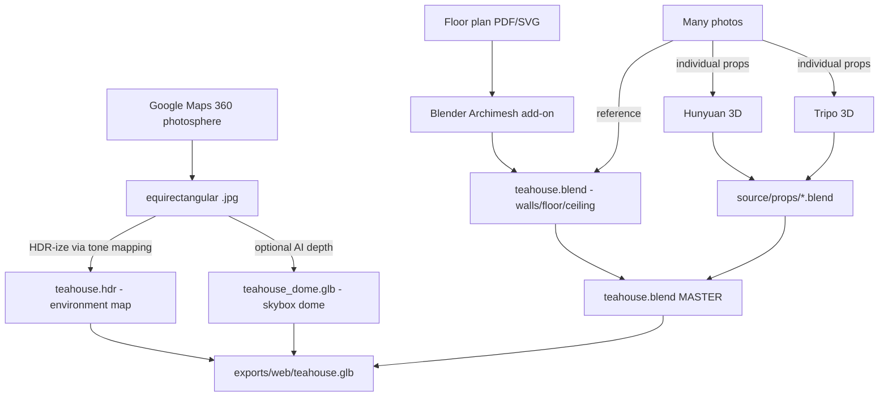

# Asset Acquisition & Production Plan

The roadmap for replacing **stub geometry** with the **real tea house**. This document is updated as inputs arrive and assets ship. Read alongside [`source/CONVENTIONS.md`](CONVENTIONS.md) (how to author) and [`../GOALS.md`](../GOALS.md) (current sharp focus).

## What we have to work with

| Input | What it gives us | Where it goes |
|---|---|---|
| **Photos** (many) | Reference for hand-modeling, photogrammetry of single objects, texture sources, AI image-to-3D inputs | `source/captures/photos/<subject>/` |
| **Google Maps 360 photosphere** | Single-viewpoint environment map (skybox + ambient lighting + visual reference) | `source/captures/panoramas/teahouse-streetview.jpg` |
| **Floor plan (to be made)** | Authoritative wall positions, room dimensions, doorways | `source/floorplan/teahouse.{pdf,svg,blend}` |
| **Hunyuan 3D 2.0** (you have it) | High-quality single-prop generation from a photo | local GPU pipeline → `source/props/<name>.blend` |
| **Tripo 3D** (you have it) | Fast single-prop generation from a photo | cloud or local → `source/props/<name>.blend` |

## What each input is good for (and not good for)

| Tool / input | Best at | NOT good at |
|---|---|---|
| Floor plan | Wall positions, dimensions, doorway placement, scale truth | Anything organic (cushions, fabric, plants) |
| Google Street View 360 | Whole-room ambient/IBL lighting, sky-dome backdrop, visual reference for materials | Walkable geometry (single viewpoint = no parallax = no real 3D) |
| Photos (regular) | Photogrammetry of small/medium objects, texture sources, AI-prop reference | Whole rooms (rarely yields clean walls) |
| Hunyuan 3D | Hero props (carved screen, ornate teapots, lanterns, plants) — best fidelity per prop | Walls / floor / large rooms |
| Tripo 3D | Filler props (cups, saucers, books, decorations) — fast iteration | Same; not for rooms |

The key insight: **rooms come from the floor plan + photos as reference**, **props come from AI image-to-3D**. Different tools for different layers.

## Architecture: how everything composes



## Phase plan

### Phase A — Extract the Google Maps 360 photosphere

Goal: get the equirectangular `.jpg` out of Street View into `source/captures/panoramas/teahouse-streetview.jpg`.

Options (try in order):

1. **Ask the tea house owner.** They uploaded the photosphere. They have the original equirectangular file (probably 8K+, vastly higher quality than what Google serves to viewers). One short message — by far the best path.

2. **Browser extension grab.** Use [Pano Grabber](https://chromewebstore.google.com/) or [Street View Download 360](https://svd360.istreetview.com/) — paste the Maps URL, get a stitched equirect file. Quality: ~4K-8K. Free.

3. **Manual tile capture via dev tools.**
   - Open the Maps photosphere in Chrome
   - F12 → Network tab → filter `cbk0.google.com` or `streetviewpixels`
   - Pan around the panorama; tiles get fetched
   - Save tiles, stitch with [pano-tools](https://github.com/heygrady/pano-grabber) or imagemagick
   - Quality: as good as Google serves (typically 6K wide equirect)

4. **Google Street View Static API.** Paid, ~$7 per 1000 images, but gives you a clean equirectangular at requested resolution. Overkill for one image but reliable.

**Output:** `source/captures/panoramas/teahouse-streetview.jpg` — equirectangular `.jpg` (2:1 aspect ratio, ideally ≥4096×2048).

### Phase B — Reverse-engineer the floor plan ✅ DONE

> **Status:** initial pass complete. See [`teahouse-plan.png`](floorplan/teahouse-plan.png) (with Photoshop source) and [`teahouse-measurements.md`](floorplan/teahouse-measurements.md). Multi-room layout with three floor levels (entrance / recessed corridor / upper level via stairs) is now in `spec/teahouse.room.json` and rendering in the stub runtime.
>
> Outstanding: refine measurements with on-site tape readings — see the "Things still to confirm on-site" checklist in [`teahouse-measurements.md`](floorplan/teahouse-measurements.md).

Goal: produce a 2D top-down plan with measurements at `source/floorplan/teahouse.svg` (and `.blend`).

Steps:

1. **Take 4-6 reference photos** standing at the corners of the room shooting toward the opposite walls.
2. **Take ~10 tape-measure readings** at key points:
   - Each wall length
   - Door width and position from corner
   - Ceiling height
   - Distance from each major fixed object (couch, screen, low table) to the nearest two walls
3. **Sketch in any 2D tool**:
   - **Inkscape** (free, vector) → exports SVG
   - **draw.io** / **Excalidraw** → quick rectangles
   - **Sweet Home 3D** (free) → drag-drop floor plan with auto 3D preview, exports OBJ/glTF
   - **SketchUp Free** (browser, free) → measured drafting → exports SKP/glTF
   - **Pen & paper, scan, trace in Inkscape** — totally fine
4. **Save the plan** as `source/floorplan/teahouse.svg` and a measurements sidecar:

```
source/floorplan/
  teahouse.svg                  # the drawing
  teahouse-measurements.md      # tape readings in meters
  teahouse-photos/              # the corner reference shots
```

5. **Update [`spec/teahouse.room.json`](../spec/teahouse.room.json)** `dimensions` field to match the real measurements. The stub renderer immediately reflects them.

### Phase C — Build accurate walls in Blender (from floor plan)

Goal: `source/rooms/teahouse.blend` master scene with correctly-shaped walls, doorways, ceiling, and named colliders matching [`source/CONVENTIONS.md`](CONVENTIONS.md).

Three workflows, pick whichever is comfortable:

#### C.1 — Sweet Home 3D → Blender (easiest)

1. Recreate the floor plan in [Sweet Home 3D](https://www.sweethome3d.com) (free, drag-drop walls)
2. Add furniture placeholders to lock down positions
3. **File → Export to OBJ** (or glTF if you install the add-on)
4. Open `source/rooms/teahouse.blend` in Blender, **File → Import → Wavefront (OBJ)**
5. Rename objects to `collider_walls`, `collider_floor`, `collider_ceiling`, etc.
6. Apply Principled BSDF materials (your photos as base color textures)

#### C.2 — Blender Archimesh add-on (most flexible)

1. Blender → Edit → Preferences → Add-ons → enable **Archimesh** (ships with Blender)
2. Add → Mesh → **Archimesh > Add Room** → set dimensions from your floor plan
3. Add doors and windows via Archimesh's wizard
4. Output is real geometry; rename per conventions
5. Save to `source/rooms/teahouse.blend`

#### C.3 — Manual Blender modeling (most accurate)

1. New Blender file at `source/rooms/teahouse.blend`
2. **Image → Reference** → drop your `teahouse.svg` floor plan, scale to actual size
3. Box-model walls along the SVG outline
4. Apply transforms (Object → Apply → All Transforms)
5. Name objects per [`source/CONVENTIONS.md`](CONVENTIONS.md)

**Output:** `source/rooms/teahouse.blend` — clean walls, named colliders, real dimensions, no decoration yet.

### Phase D — Generate props with Hunyuan 3D and Tripo 3D

Goal: every distinctive object in the tea house exists as a `source/props/<name>.blend`.

Inventory (from your reference image and what we know):

| Prop | Recommended tool | Why | Output path |
|---|---|---|---|
| Carved wooden screen (your reference photo) | **Hunyuan 3D** + Blender hand-finish | Hero prop, lattice cutouts need careful alpha texturing | `source/props/carved-screen.blend` |
| Turquoise upholstered couch / seating | **Hunyuan 3D** | Large smooth surfaces, AI handles fabric well | `source/props/couch.blend` |
| Teacup (the one in `GOALS.md` interaction!) | **Tripo 3D** | Generic shape, fast iteration | `source/props/teacup.blend` |
| Teapot | **Hunyuan 3D** | Spout/handle topology benefits from higher quality | `source/props/teapot.blend` |
| Lantern / hanging lamp | **Tripo 3D** | Simple form | `source/props/lantern.blend` |
| Paper umbrella | **Tripo 3D** | Flat-ish, simple | `source/props/umbrella.blend` |
| Low table | **Tripo 3D** or hand-model | Box-y, easy either way | `source/props/low-table.blend` |
| Plants in pots | **Hunyuan 3D** | Organic shapes hard to hand-model | `source/props/plant-fern.blend`, `plant-monstera.blend` |
| Wood-tile flooring texture | **Photos** + Substance / Materialize | Tileable PBR, not a 3D object | `source/textures/wood-tile/` |

#### Hunyuan 3D 2.0 workflow

```bash
# Assuming you already have it set up (HuggingFace ComfyUI nodes or the standalone)
# Per-prop:
# 1. Crop a clean photo of the prop, mask out the background (use rembg or PhotoRoom)
# 2. Feed the masked image into Hunyuan
# 3. It outputs a textured GLB
# 4. Bring into Blender:
blender source/props/carved-screen.blend --python -c "
import bpy
bpy.ops.import_scene.gltf(filepath='/path/to/hunyuan-output.glb')
"
# 5. Decimate if >30k tris, fix normals, repaint texture seams from photo
# 6. Save .blend
```

#### Tripo 3D workflow (cloud)

1. https://www.tripo3d.ai → upload masked prop photo
2. Choose quality tier (free 3 generations/day, paid for more)
3. Download `.glb`
4. Import into a fresh Blender file → save as `source/props/<name>.blend`
5. Same cleanup as Hunyuan

#### Cleanup checklist (apply to every AI-generated prop)

- **Decimate** to <30k tris (Modifier → Decimate → 0.3-0.5 ratio)
- **Re-UV** if the AI gave you weird unwrap (UV → Smart UV Project)
- **Bake** photo-correct albedo by projecting your reference photo onto the mesh
- **Apply transforms** (Object → Apply → All Transforms)
- **Rename** per portable conventions: `interactable_teacup_1`, `interactable_teapot_main`, etc.
- **Add custom properties** as needed: `kind: pickup`, `event: drink`

### Phase E — Process the Google 360 into environment lighting

Goal: turn the equirectangular photosphere into a usable lighting backdrop.

```bash
# Convert JPG to HDR equirect (gives Blender's IBL much better lighting range)
# Tool: hdrihaven-style conversion, or simply use the .jpg as-is (Blender accepts both)

# Option A: use it as Blender's HDRI environment
# In Blender: World > Surface > Background > Environment Texture > teahouse-streetview.jpg
# This gives ambient lighting that matches the real room's mood

# Option B: render it as a sky-dome geometry (visible backdrop through windows)
# Blender > Add > Mesh > UV Sphere > flip normals > apply equirect texture > emission shader
# This becomes a 'cam_sky' object — visible but unlit

# Option C (advanced): use depth estimation to unproject the panorama into a partial mesh
#   - Tool: ZoeDepth or Marigold (HuggingFace)
#   - Output: per-pixel depth map
#   - Unproject to point cloud → mesh
#   - Useful as a visual fill behind doorways / windows where we don't have geometry
```

**Output:**
- `source/captures/panoramas/teahouse-streetview.jpg` — the raw photosphere
- `source/textures/teahouse-environment.hdr` — Blender-ready HDRI (if converted)
- (Optional) `source/props/skydome.blend` — sphere mesh with the panorama texture

### Phase F — Composite + bake the master scene

Goal: `source/rooms/teahouse.blend` has everything in place; `tools/export-all.sh` produces `exports/web/teahouse.glb`.

1. Open `source/rooms/teahouse.blend` (the walls from Phase C)
2. **Append** each prop from `source/props/*.blend` (File → Append → select object)
3. Position props per the floor plan
4. Tag with portable name prefixes (`interactable_*`, `sit_*`, `light_*`)
5. Set the World HDRI to `teahouse-environment.hdr`
6. Add `light_*` empties matching the real lights you see in photos
7. **Bake** ambient occlusion + subtle indirect lighting into vertex colors or a baked texture (optional, gives the export a richer feel without runtime GI)
8. Save
9. Run from repo root:

```bash
bash tools/export-all.sh
```

10. Update `spec/teahouse.room.json`:
    - Set `dimensions` to real measurements
    - Replace placeholder `spawnPoints`, `sitPoints`, `interactables` positions with measured-from-floorplan coordinates
    - Run `pnpm validate:spec` to confirm schema compliance

11. Reload the dev client. The R3F runtime swaps from `<StubRoom>` to a glb loader (a one-line component change — we'll add that swap when the .glb first appears).

## Tools you'll need to install

| Tool | What for | Already have? | Install |
|---|---|---|---|
| Blender 4.2 LTS | Master scene authoring, all prop cleanup | check | https://blender.org |
| Hunyuan 3D 2.0 | Hero props from photos | yes | already set up |
| Tripo 3D | Filler props from photos | yes | already set up |
| Sweet Home 3D | Quick floor plan → 3D walls | optional | https://sweethome3d.com |
| Inkscape | Drawing the SVG floor plan | optional | `sudo apt install inkscape` |
| rembg or PhotoRoom | Remove background from prop photos | recommended | `pip install rembg` |
| imagemagick | Stitching tiles, resizing panoramas | recommended | `sudo apt install imagemagick` |

## Estimated effort

| Phase | Time | Bottleneck |
|---|---|---|
| A — Extract panorama | 5–60 min | Depends which method works first |
| B — Floor plan | 1–3 hours | Tape measurements + sketching |
| C — Walls in Blender | 2–4 hours | Mostly Blender click-time |
| D — All props via Hunyuan/Tripo | 4–8 hours | Per-prop cleanup is the slow part (~30 min each) |
| E — Panorama → HDRI | 30 min | One-time |
| F — Composite + spec update | 2–3 hours | Manual placement |
| **Total** | **2–3 weekends** | |

## Order of operations (recommended)

```mermaid
gantt
  title Asset acquisition timeline
  dateFormat X
  axisFormat %s
  section Phase A panorama
  Extract Street View 360         :a, 0, 1
  section Phase B floor plan
  Tape measure on site            :b, 0, 2
  Draw SVG plan                   :after b, 1
  Update spec dimensions          :crit, after b, 1
  section Phase C walls
  Build walls Blender             :c, after b, 3
  section Phase D props
  Carved screen Hunyuan           :d1, after c, 1
  Couch Hunyuan                   :d2, after d1, 1
  Teacup Tripo                    :d3, 0, 1
  Teapot Hunyuan                  :d4, after d3, 1
  Other props                     :d5, after d4, 2
  section Phase E lighting
  HDRI from panorama              :e, after a, 1
  section Phase F composite
  Master scene assembly           :f, after c, 2
  spec.json position update       :f2, after f, 1
  Run export pipeline             :f3, after f2, 1
```



You can do Phase A, Phase B (measurements), and Phase D (props in parallel via Hunyuan/Tripo) **simultaneously** — they're independent.

## What changes in the codebase as assets land

| When this drops | Code change | Visual result |
|---|---|---|
| `spec.dimensions` updated | (no code change — `<StubRoom>` reads it) | Stub room snaps to real proportions |
| First prop `.glb` lands in `source/props/` | (no code change yet — composited via Blender into master) | Stub still active until Phase F |
| `exports/web/teahouse.glb` first exists | Add `<GlbRoom>` component, swap from `<StubRoom>` in `Scene.tsx` | Real geometry replaces primitives |
| `exports/web/teahouse.ksplat` first exists | Add `<SplatShell>` overlay (drei-style) | Photoreal shell visible |
| HDRI dropped in | Set `<Environment files="..." />` instead of `preset="warehouse"` in `Scene.tsx` | Lighting matches the real room |

The runtime adapter does NOT need to know about Hunyuan / Tripo / Sweet Home 3D — those produce inputs to Blender, and Blender's master scene is the single thing the export pipeline cares about.

## Spec updates that drop with this work

```diff
  "spec/teahouse.room.json"
- "dimensions": { "width": 6, "length": 8, "height": 3 }   // PLACEHOLDER
+ "dimensions": { "width": 5.4, "length": 7.2, "height": 2.8 }   // measured

- "spawnPoints": [{ "id": "entrance", "position": [0, 0, 3.5], ...}]   // PLACEHOLDER
+ "spawnPoints": [{ "id": "entrance", "position": [-2.7, 0, 3.6], ...}]   // floor-plan derived

- "interactables": [{ "id": "teacup_1", "position": [1.4, 0.62, -0.75], ...}]  // PLACEHOLDER
+ "interactables": [
+   { "id": "teacup_1",  "position": [<measured>, 0.62, <measured>], "kind": "pickup", "event": "drink", "respawnAfter": 30 },
+   { "id": "teacup_2",  "position": [<measured>, 0.62, <measured>], "kind": "pickup", "event": "drink", "respawnAfter": 30 },
+   { "id": "teapot_main","position": [<measured>, 0.62, <measured>], "kind": "pour",   "event": "pour",  "respawnAfter": 60 }
+ ]
```

The `kind: "pour"` is the new variant we'll add to [`spec/room.schema.json`](../spec/room.schema.json) when shipping the drink-tea goal — see [`../GOALS.md`](../GOALS.md) § "How this maps to the existing codebase".

## Open questions

- Do we attempt photogrammetry of the **whole room** as a fallback (in case the floor-plan + manual reconstruction is slower than expected)? My recommendation: skip — floor plan + AI props is faster and cleaner.
- Do we want a **Gaussian Splat** of the room at all? Without a 360 video, we can't make a high-quality splat from one panorama. We can synthesize a partial splat from the photos via NeRF Studio, but quality will be uneven. My recommendation: defer until you have a 360 video walkthrough.
- Texture atlas budget: keep all room textures under 30 MB total when KTX2-compressed. Each prop ≤ 2 MB.

## Done = move to next goal

This phase is complete when:

- [ ] `source/floorplan/teahouse.svg` exists with measurements
- [ ] `source/captures/panoramas/teahouse-streetview.jpg` exists
- [ ] `source/rooms/teahouse.blend` exists with named colliders matching the floor plan
- [ ] `source/props/` contains at least: `carved-screen.blend`, `couch.blend`, `teacup.blend`, `teapot.blend`, `lantern.blend`, `low-table.blend`
- [ ] `tools/export-all.sh` runs cleanly and produces `exports/web/teahouse.glb` >0 bytes
- [ ] `spec/teahouse.room.json` is updated with real measurements and validates
- [ ] The R3F runtime swaps from stub to real geometry on next page reload (one-time `<GlbRoom>` swap in `Scene.tsx`)
