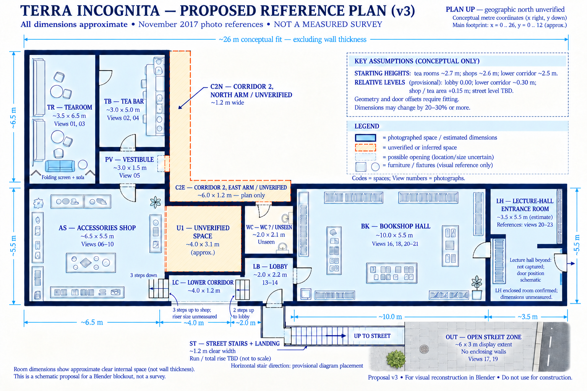
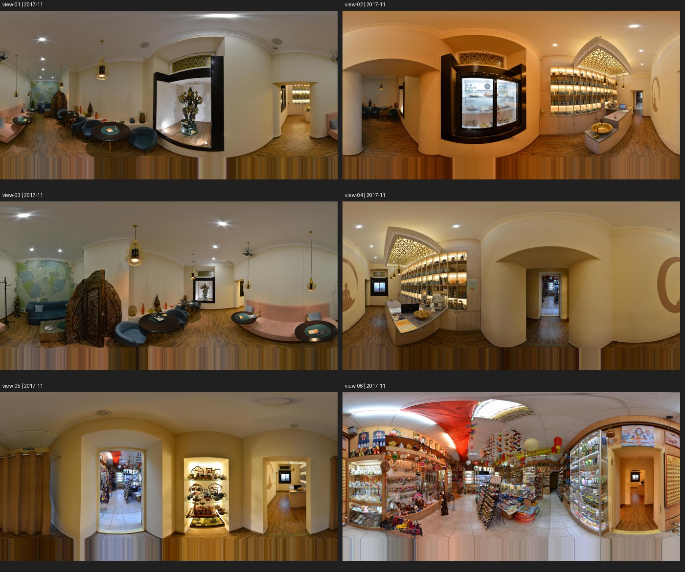
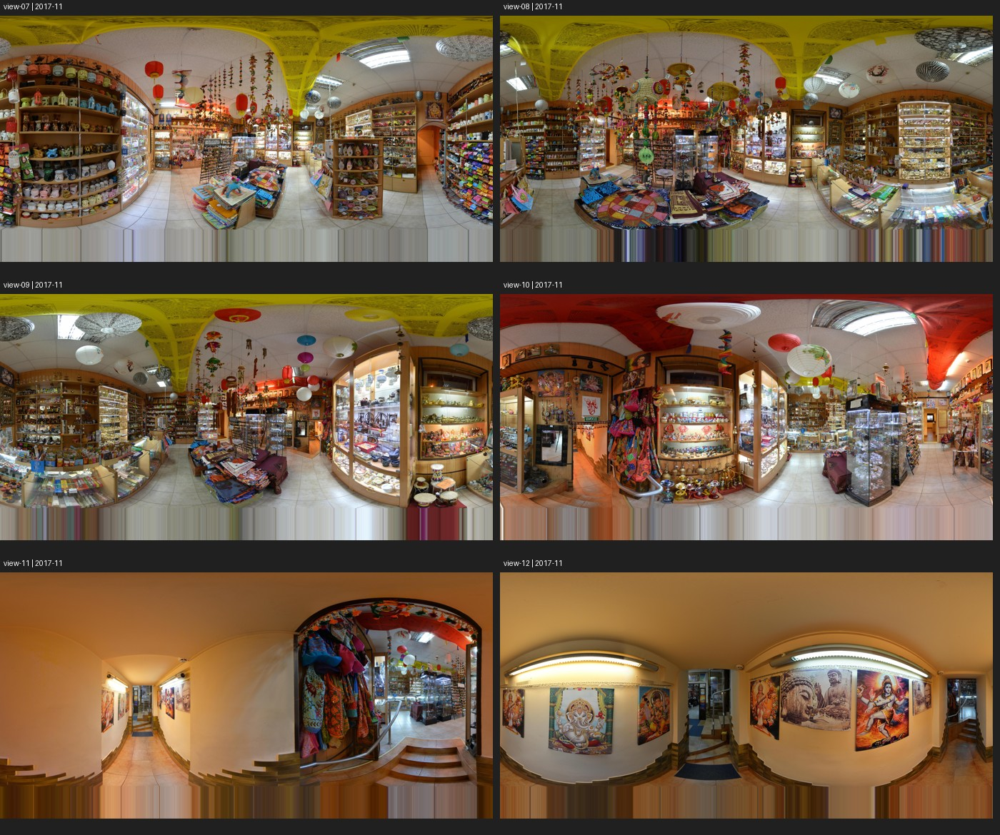
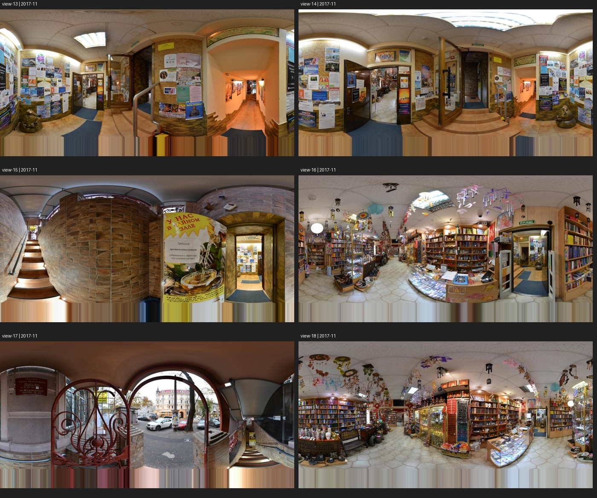
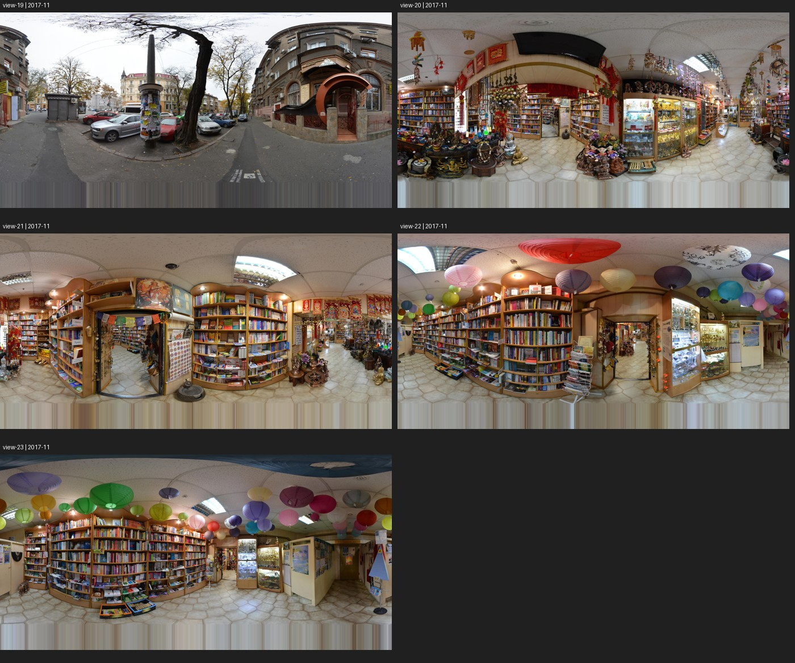

# Terra Incognita reference panorama tour

23 downloaded panoramas, all 10000 x 5000 pixels. Capture date: November 2017. Attribution: From the Owner, Photo by: Cube Online Україна. These are historical visual references, not a surveyed current floor plan.

## Browse the views

[](../../floorplan/blueprint-proposal-v3.png)

[Blueprint assumptions and suggested dimensions](../../floorplan/blueprint-proposal-v3.md). LH is the enclosed lecture-hall entrance room (references 20-23); the signed door is visible in view 23. View 19 is the outside street, OUT.

All 23 panoramas are visible in the previews below. Click an overview to open it, or use the viewpoint links in the table to open a full-resolution panorama.

### Views 01–06 — Tearoom, tea bar, vestibule, and shop

[](contact-sheet-01.jpg)

### Views 07–12 — Accessories shop and lower corridor

[](contact-sheet-02.jpg)

### Views 13–18 — Entrance lobby, stairs, and bookshop

[](contact-sheet-03.jpg)

### Views 19–23 — Street and rear bookshop

[](contact-sheet-04.jpg)

## Full-resolution views and connections

[Floor-plan comparison](../../floorplan/panorama-comparison.md) | [Full metadata and link graph](tour-manifest.json)

[Space code register](../../floorplan/space-codes.json): codes identify places; numbered views identify camera positions.

Room names below are visual interpretations. IDs identify camera positions, not rooms. Neighbours are API tour links; they are not automatically doorways.

| View | Space code | Observed area | Linked views |
|---|---|---|---|
| [view-01](terra-incognita-tearoom-2017-11.jpg) | TR | Tearoom: seating and mirror | [view-02](view-02.jpg), [view-03](view-03.jpg) |
| [view-02](view-02.jpg) | TB | Tea bar: opening toward tearoom | [view-01](terra-incognita-tearoom-2017-11.jpg), [view-04](view-04.jpg) |
| [view-03](view-03.jpg) | TR | Tearoom: sofa and carved screen | [view-01](terra-incognita-tearoom-2017-11.jpg) |
| [view-04](view-04.jpg) | TB | Tea bar: counter and vestibule doorway | [view-02](view-02.jpg), [view-05](view-05.jpg) |
| [view-05](view-05.jpg) | PV | Pre-bar vestibule: shop doorway and curtained opening | [view-06](view-06.jpg), [view-04](view-04.jpg) |
| [view-06](view-06.jpg) | AS | Accessories shop: doorway back to vestibule | [view-05](view-05.jpg), [view-07](view-07.jpg) |
| [view-07](view-07.jpg) | AS | Accessories shop: central displays | [view-06](view-06.jpg), [view-08](view-08.jpg) |
| [view-08](view-08.jpg) | AS | Accessories shop: display counters | [view-09](view-09.jpg), [view-07](view-07.jpg) |
| [view-09](view-09.jpg) | AS | Accessories shop: original requested cabinet viewpoint | [view-10](view-10.jpg), [view-08](view-08.jpg) |
| [view-10](view-10.jpg) | AS | Accessories shop: stair threshold | [view-09](view-09.jpg), [view-11](view-11.jpg) |
| [view-11](view-11.jpg) | LC | Lower corridor: three steps up to shop | [view-12](view-12.jpg), [view-10](view-10.jpg) |
| [view-12](view-12.jpg) | LC | Lower corridor: toward entrance lobby | [view-13](view-13.jpg), [view-11](view-11.jpg) |
| [view-13](view-13.jpg) | LB | Entrance lobby: corridor threshold | [view-12](view-12.jpg), [view-14](view-14.jpg) |
| [view-14](view-14.jpg) | LB | Entrance lobby: bookshop and street-stair branch | [view-15](view-15.jpg), [view-16](view-16.jpg), [view-13](view-13.jpg) |
| [view-15](view-15.jpg) | ST | Entrance stair passage | [view-14](view-14.jpg), [view-17](view-17.jpg) |
| [view-16](view-16.jpg) | BK | Bookshop: entrance from lobby | [view-14](view-14.jpg), [view-18](view-18.jpg) |
| [view-17](view-17.jpg) | ST, OUT | Exterior entrance: top of stair passage | [view-19](view-19.jpg), [view-15](view-15.jpg) |
| [view-18](view-18.jpg) | BK | Bookshop: central counters and shelving | [view-20](view-20.jpg), [view-16](view-16.jpg) |
| [view-19](view-19.jpg) | OUT | Street outside venue | [view-17](view-17.jpg) |
| [view-20](view-20.jpg) | BK | Bookshop: inner circulation | [view-18](view-18.jpg), [view-21](view-21.jpg) |
| [view-21](view-21.jpg) | BK | Bookshop: rear doorway/threshold area | [view-22](view-22.jpg), [view-20](view-20.jpg) |
| [view-22](view-22.jpg) | LH | Lecture-hall entrance room: lanterns and shelving | [view-21](view-21.jpg), [view-23](view-23.jpg) |
| [view-23](view-23.jpg) | LH | Lecture-hall entrance room: recessed door with Lecture hall sign | [view-22](view-22.jpg) |

## Coverage and limits

The crawl followed the seed panorama links, accepting the same date and attribution within 65 metres and at most 30 metadata requests. It reached 23 views with no queued links left. The actual camera locations are within about 35 metres of the seed. This is the connected tour, not proof of complete coverage of the building or business gallery.

The toilet, corridor 2, and lecture hall beyond the signed door remain unobserved. LH is the enclosed entrance room, confirmed by the user and the sign in view 23. View 19 is outside street (OUT); view 17 documents the exterior entrance.

The full image bottoms contain stretched bands; mirrors contain virtual reflections. Neither should be used as real floor/wall measurements. GPS and compass values are not indoor survey control points.

The original shop link is now recovered in view-09. Maps-facing IDs initially returned 404; API-native IDs obtained from location metadata and links succeeded. No API keys or session credentials are stored in the manifest.

## Repeat or resume

From the repository root, with GOOGLE_MAPS_API_KEY set locally or in the ignored .env file:

```powershell
uv tool run --from streetview-dl python tools/capture-reference-tour.py --download
```

The script verifies existing images, keeps viewpoint IDs stable across reruns, and rejects tile failures rather than silently saving black gaps. The JPG panoramas and contact sheets are versioned with the project at the user's request so the reference archive is complete. Metadata and observations remain small reviewable text files. Images remain third-party references and are not included in runtime exports or relicensed by the project.
