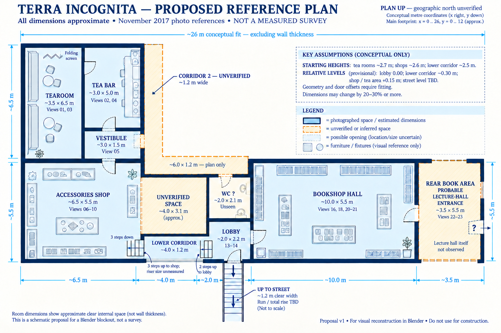

# Proposed reference blueprint — version 1

> Superseded by [version 2](blueprint-proposal-v2.md): corrected tearoom seating orientation, horizontal street stairs, an open exterior zone, and short space codes. This file preserves the earlier proposal.

Prepared 2026-11-01 from the original plan sketch and the November 2017 panorama tour. This is a schematic modeling proposal, not a measured survey. It does not change the runtime spec.

## Is the rear book area the entrance to the lecture hall?

Probably: views 22–23 occupy the far end of the photographed route, consistent with the original plan's label “Entrance to the Lecture Hall.” The shelving and lanterns led to the descriptive label “rear book area”; that label was not a claim that it is a separate bookstore. For this proposal, use **Rear book area / probable lecture-hall entrance**. The identity is inferred from the plan and sequence, and the lecture hall itself remains unseen. Do not invent a measured lecture-room footprint or assume the previous two-room split is confirmed.

## Suggested starting dimensions

All dimensions below are **approximate internal clear dimensions in metres**, chosen for a first Blender blockout. They combine the old sketch's relationships with visual impressions from the tour. No image-based calibration, measured control length, or survey has been performed. They are modeling assumptions, not quantities recovered from photogrammetry. A 20–30% change during fitting would not be surprising; that is a practical allowance, not a calculated confidence interval.

| Space | Proposed width × depth | Suggested starting clear height | Basis / confidence |
|---|---|---|---|
| Tearoom | ~3.5 × 6.5 m | ~2.7 m | Long narrow seating room, views 01/03; moderate topology confidence, low dimension confidence |
| Tea bar | ~3.0 × 5.0 m | ~2.7 m | Narrow counter room, views 02/04; dimensions uncalibrated |
| Pre-bar vestibule | ~3.0 × 1.5 m | ~2.7 m | Display niche and multiple openings, view 05 |
| Accessories shop | ~6.5 × 5.5 m | ~2.6 m | Several overlapping store views 06–10; perimeter fit still needed |
| Lower corridor | ~4.0 × 1.2 m | ~2.5 m | Narrow recessed passage, views 11/12 |
| Internal entrance lobby / spawn | ~2.0 × 2.2 m | ~2.6 m | Views 13/14; excludes the street stair passage |
| Bookshop hall | ~10.0 × 5.5 m | ~2.6 m | Views 16/18/20/21; not independently measured |
| Rear book area / probable lecture-hall entrance | ~3.5 × 5.5 m | ~2.6 m | Views 22/23 and original plan label; room function and bounds provisional |
| Toilet | ~2.0 × 2.1 m | ~2.5 m | Placeholder inherited from plan; unseen in tour |
| Corridor 2, north arm | ~1.2 × 6.5 m | ~2.5 m | Plan-only placeholder; unseen in tour |
| Corridor 2, horizontal arm | ~6.0 × 1.2 m | ~2.5 m | Plan-only placeholder; includes shared elbow with north arm, not additive floor area |
| Street stair passage | ~1.2 m clear width; run and total rise TBD | TBD | Seen in 15/17; do not turn it into a flat exit |

Conceptual fit uses a roughly **26 × 12 m main footprint**, excluding the street stair passage and wall thickness. This is the footprint of the proposed arrangement, not a measurement of the building. Internal wall thickness can initially be modeled at ~0.15 m; perimeter walls at ~0.30 m, both unverified. Final external dimensions must include wall construction rather than simply reuse the 26 × 12 figure.

Start typical door openings at ~0.9 m wide and ~2.0 m high, adjusting against the photos. Keep the corridor's lower elevation (~−0.30 m), lobby datum (0.00 m), and upper shop/tea area (~+0.15 m) as provisional values from the previous plan. Three visible shop steps support the count, not an exact 0.15 m riser. Street level is a separate unknown elevation.

## Drawing contract

Top-down orientation follows the original sketch: tearoom upper left; tea bar immediately right; shop below them; recessed corridor and lobby along the lower middle; large bookshop to the right; probable lecture-hall entrance at the far right. Up on the sheet is **plan-up, not verified geographic north**.

Proposed clear-zone diagram coordinates (x right, y down, metres; these are drawing coordinates, not runtime world coordinates):

- Tearoom: x 0–3.5, y 0–6.5.
- Tea bar: x 3.5–6.5, y 0–5.0; vestibule: x 3.5–6.5, y 5.0–6.5.
- Accessories: x 0–6.5, y 6.5–12.0.
- Unverified north corridor arm: x 6.5–7.7, y 0–7.7; its run above the elbow is 6.5 m.
- Unverified horizontal corridor arm: x 6.5–12.5, y 6.5–7.7. These arms overlap at their elbow.
- Unresolved plan area: x 6.5–10.5, y 7.7–10.8. Hatch it and label “Unverified space”; do not assume a room function.
- Unverified toilet: x 10.5–12.5, y 7.7–9.8.
- Lower corridor: x 6.5–10.5, y 10.8–12.0.
- Lobby: x 10.5–12.5, y 9.8–12.0.
- Bookshop: x 12.5–22.5, y 6.5–12.0.
- Rear book / probable lecture-hall entrance: x 22.5–26.0, y 6.5–12.0.
- Street stair passage: diagrammatic extension downward from lobby, run not to scale.

Solid outlines indicate a photographed space whose dimensions are still estimated. Dashed outlines indicate unverified geometry/function. Door locations, stair run angles, and wall thickness are illustrative and must be fitted later. Mirror reflections and stretched panorama bottoms must not be traced as real geometry.

## Image generation

The companion blueprint image is generated with the built-in image-generation tool. Its dimension table above is the authoritative proposal if generated graphic labels or proportions differ. This is an explanatory bitmap, not CAD geometry or a construction drawing. The complete image prompt is saved in `blueprint-proposal-v1.prompt.txt`.
