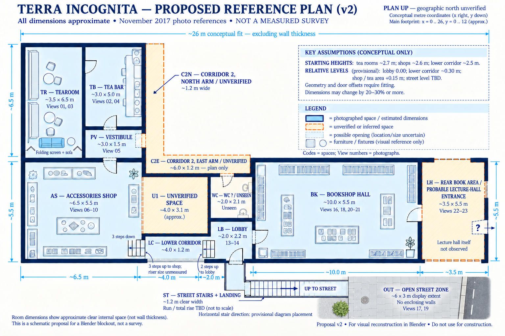
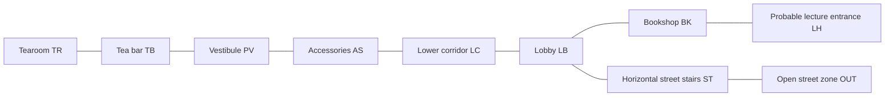

> Superseded by [version 3](blueprint-proposal-v3.md), which corrects the LH enclosure and identification.

# Proposed reference blueprint — version 2

Updated 2026-11-01 with the user's orientation corrections. Dimensions remain unmeasured modeling estimates from the original sketch and November 2017 panoramas. Runtime geometry has not been changed.

## Changes from version 1

- **TR:** the folding screen and blue sofa are now at the bottom end of the tearoom. Views 01/03 show the sofa and screen together at the end opposite the bar doorway; the user's correction establishes that this end is down on the plan. The upper shared-wall doorway to TB stays in place. The room footprint is unchanged.
- **ST:** the street stair flight is horizontal on the drawing, with a short turning landing from LB. It rises toward OUT. The rightward direction is a provisional drawing choice; the user confirmed horizontal orientation, not left-versus-right geographic direction. Actual run, riser count, and total rise remain TBD.
- **OUT:** added a small open pavement/street patch without enclosing walls. The suggested ~6 × 3 m extent is a convenient modeling crop, not a measured boundary or width of the real street.
- Every space has a stable short code. These codes refer to places; `view-01` through `view-23` still identify photographs.

## Space codes and suggested dimensions

The [machine-readable code register](space-codes.json) stores the same identifiers and reference views. Unseen spaces remain in the plan as explicitly unverified placeholders.

| Code | Space | Suggested clear size | Reference views | Status |
|---|---|---|---|---|
| **TR** | Tearoom | ~3.5 × 6.5 m | 01, 03 | Photographed; seating nook orientation corrected by user |
| **TB** | Tea bar | ~3.0 × 5.0 m | 02, 04 | Photographed |
| **PV** | Pre-bar vestibule | ~3.0 × 1.5 m | 05 | Photographed |
| **AS** | Accessories shop | ~6.5 × 5.5 m | 06–10 | Photographed |
| **LC** | Lower corridor | ~4.0 × 1.2 m | 11, 12 | Photographed; three visible steps up to AS |
| **LB** | Internal entrance lobby / spawn | ~2.0 × 2.2 m | 13, 14 | Photographed; separate from street level |
| **BK** | Bookshop hall | ~10.0 × 5.5 m | 16, 18, 20, 21 | Photographed |
| **LH** | Rear book area / probable lecture-hall entrance | ~3.5 × 5.5 m | 22, 23 | Area photographed; lecture-entrance identity inferred; actual hall unseen |
| **WC** | Toilet | ~2.0 × 2.1 m | None identified | Unverified plan placeholder |
| **C2N** | Corridor 2, north arm | ~1.2 × 6.5 m | None identified | Unverified plan placeholder |
| **C2E** | Corridor 2, east/horizontal arm | ~6.0 × 1.2 m | None identified | Unverified plan placeholder; shares elbow with C2N |
| **U1** | Unverified central space | ~4.0 × 3.1 m diagram remainder | None identified | Function and boundaries unknown; not a confirmed room |
| **ST** | Street stair passage and landing | ~1.2 m clear width; run/rise TBD | 15, 17 | Photographed; horizontal plan orientation supplied by user |
| **OUT** | Open street/pavement reference zone | ~6.0 × 3.0 m selected modeling extent | 17, 19 | Exterior photographed; crop size proposed, no enclosing walls |

Useful references can now be phrased as “the TR screen,” “the AS–LC steps,” “the LB–ST landing,” or “the ST–OUT exit.” If a space later subdivides, retain its code as the parent identifier rather than silently reassigning it.

## Circulation

C2N, C2E, WC, and U1 are excluded from this confirmed-route schematic because their connections have not been verified from the tour. The stair flight is horizontal in plan while changing elevation; it is not a flat corridor.

## Scale and drawing limits

Keep the version 1 starting heights: tea rooms ~2.7 m, shops ~2.6 m, lower corridor ~2.5 m. Relative floor levels remain provisional: LB = 0, LC ~−0.30 m, AS/tea area ~+0.15 m; street elevation is unknown. No metric calibration has been performed. A 20–30% or larger revision during fitting is possible, not a calculated error bound.

The main conceptual footprint remains ~26 × 12 m, excluding wall thickness, ST, and OUT. Internal room zones and their drawing coordinates otherwise follow [version 1's dimension proposal](blueprint-proposal-v1.md). Its old downward stair depiction and top-end screen placement are superseded by this version. Street stairs and outside are diagrammatic and should not be measured off the bitmap. Door swings and furniture symbols are illustrative; keep actual placement tied to reference photos.

Created with the built-in image-generation tool by editing v1. The [complete edit prompt](blueprint-proposal-v2.prompt.txt) is saved. This image is a visual reference, not CAD or a construction drawing.
