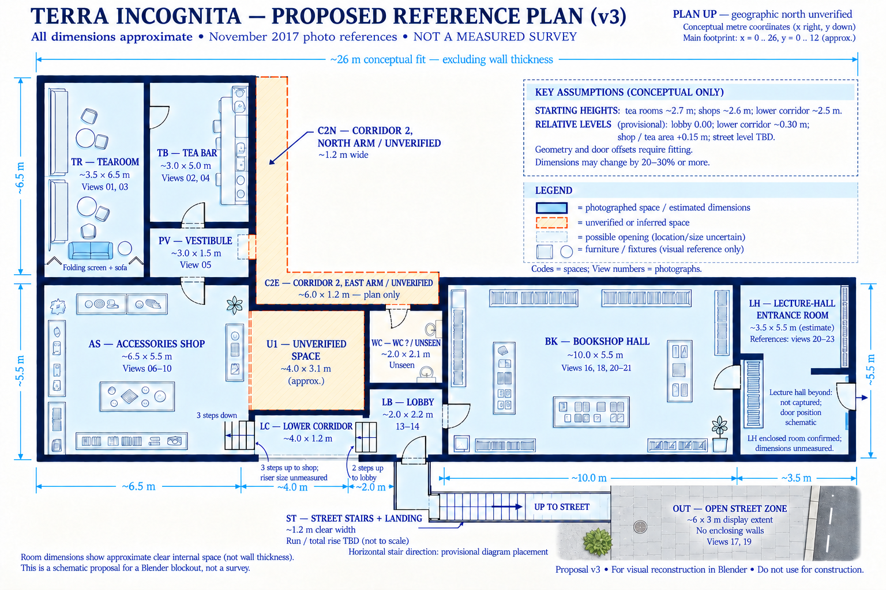

# Proposed reference blueprint — version 3

Updated 2026-11-01: **view 19 is the outside street, code OUT**. It is not part of LH. View 17 shows the exterior entrance/top of the stair passage.

**LH is a full enclosed lecture-hall entrance room**, confirmed by the user. Views 20–23 document its approach, threshold and interior. The sign above the recessed door in view 23 reads “Лекционный зал” (Lecture hall), supporting the room's identification. The lecture hall beyond the door has not been photographed in this tour.

| Reference | Evidence and interpretation |
|---|---|
| [20](../captures/panoramas/view-20.jpg) | Bookshop approach; included as context for the LH sequence, not proof of a separate room at each camera position. |
| [21](../captures/panoramas/view-21.jpg) | Framed walk-through threshold between shelving areas; supports a distinct BK–LH opening. |
| [22](../captures/panoramas/view-22.jpg) | Bookshelves, illuminated display cases, hanging paper lanterns and an opening back toward the shop. |
| [23](../captures/panoramas/view-23.jpg) | Entrance-room furnishings, projecting partition/recess, and the signed lecture-hall door. |
| [19](../captures/panoramas/view-19.jpg) | Outside street only: OUT. |

The drawing now gives LH solid enclosing walls and the same blue fill as other photographed spaces. It includes shelving and a schematic partition/door recess. The BK–LH doorway position, partition lengths, door swing and location of the onward door remain illustrative: the panorama is not a measured plan. Shelving hides parts of the walls, so their construction and thickness are not established.

LH remains **~3.5 × 5.5 m, height ~2.6 m**, an unmeasured starting proposal retained from v2. The photographs do not validate these dimensions. All other suggested dimensions and orientation assumptions follow [v2](blueprint-proposal-v2.md#space-codes-and-suggested-dimensions); the [code register](space-codes.json) contains the updated names and evidence.

Preserved: horizontal ST stairs, unwalled OUT street crop, and the TR screen/sofa at the bottom. Runtime/Blender geometry has not been changed.

Created using the built-in image tool; [saved edit prompt](blueprint-proposal-v3.prompt.txt). This supersedes v2's tentative LH label and dashed enclosure.
