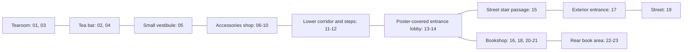

# Floor plan compared with the November 2017 panorama tour

Update: [v3 analysis](blueprint-proposal-v3.md) confirms LH as an enclosed entrance room with a signed lecture-hall door in view 23. View 19 is OUT, outside street. This supersedes tentative rear-area identification below.

Comparison made 2026-11-01 from the linked Terra Incognita reference tour. Room names below are interpretations of visible contents and the existing plan, not labels supplied by Google. This is a historical visual reconstruction, not a measured survey of the current building.

## Sources and navigation

- [Original plan image](teahouse-plan.png), with editable `teahouse-plan.psd` source. The PNG was visually inspected; the PSD layers were not inspected.
- [ASCII floor map](teahouse-ascii-map.md).
- [Measurement notes](teahouse-measurements.md).
- [Current runtime specification](../../spec/teahouse.room.json).
- [Downloaded reference index](../captures/panoramas/README.md) and [camera/link metadata](../captures/panoramas/tour-manifest.json).

The linked tour contains 23 camera positions, not 23 rooms. All metadata reports November 2017 and credits “From the Owner, Photo by: Cube Online Україна”. The traversal reached the end of the connected graph within its limits. This does not prove every room was photographed or every gallery image is linked.

## Supported circulation

The following is a schematic of the observed route. It is not north-oriented or to scale. Links describe virtual-tour navigation and should be checked against visible openings before becoming architectural connections.

## Comparison and required treatment

| Feature in the old plan | Visual evidence | Assessment for reconstruction |
|---|---|---|
| Tearoom beside tea bar | 01/03 show seating and screen; 02 shows the opening back to the seating area; 04 shows the bar's other end | Supported as connected spaces. Door offsets and shared-wall length remain estimated. |
| Carved screen location | 01 and 03 show it beside the blue sofa and leaf-pattern feature wall | Confirmed in the tearoom for this capture date. The open question in the measurement notes can be resolved for 2017. |
| “Pre Teabar” drawn in ASCII, absent from its room table | 05 shows a distinct small vestibule with a lit display niche, doorway to the shop, doorway to the bar, and a curtained opening | Keep this distinct space in the reconstruction. Current spec's `pre_teabar` is more consistent with this evidence than the older tables. The curtained opening's destination is unverified. |
| Direct tearoom → accessories doorway in ASCII doorway table D6 | The downloaded route goes through the bar and vestibule; no direct tearoom/shop passage has been established visually | Unverified, not proven absent. ASCII drawing labels D6 between bar and pre-bar, while its table calls D6 tearoom/accessories. Resolve this internal contradiction before generating geometry. |
| Accessories shop | 06-10 show overlapping views of tiled floor, wood-framed display cases, hanging ornaments, and central merchandise stands | Clearly supported. Model perimeter and openings first; avoid treating each panorama position as a separate room. |
| Three steps from recessed corridor up to accessories | 10/11 show the store threshold, three visible steps, and handrail | Step count and relative height direction are supported. Exact 0.45 m rise, 0.70 m tread, and 45-degree plan angle are not measured. |
| Lower corridor with steps at both ends | 11/12 show the long poster-lined passage and raised thresholds at either end; 13 looks back into it | Supported. The two-step entrance transition is visually plausible; confirm individual risers in matched views before locking geometry. Exact floor levels remain estimates. |
| Spawn/entrance connects to bookshop | 13/14 show the poster-covered lobby; 16 looks back through its doorway from the bookshop | Supported. Interpret `spawn` as this internal lobby/threshold, not automatically street level. |
| Outside immediately beyond D0 | 14/15/17 show additional stairs and a stone-lined passage between lobby and street entrance | The schematic omits entrance geometry. Add a separate stair passage if the entrance route is in scope; do not put a flat street directly outside the internal lobby. |
| Books store hall | 16/18 show continuous book shelving, glass display counters, and tiled circulation | Supported as a large retail space. Neither dimensions nor the complete perimeter are measured. |
| Lecture hall / lecture entry at the far end | 20-23 continue into rear shelving areas with hanging lanterns and a corridor/door approach | A rear area is observed, but no lecture room is positively identified. Do not assume these camera positions establish the two-room lecture-hall split in the ASCII/spec. |
| L-shaped “corridor 2” and toilet | No camera has yet been assigned confidently to those spaces | Retain as unverified plan information. Absence of a panorama link does not establish absence of a door or room. |
| Three numeric floor levels | Photos establish relative steps but no scale reference | Preserve `0`, `-0.30`, `+0.15` only as provisional design values. The street entrance stairs also require a separate elevation treatment. |

## The local sources disagree even before comparison with photographs

| Item | Measurement notes | ASCII table | Current JSON spec |
|---|---|---|---|
| Origin description | Center of spawn | Approximately lower corridor center | Spawn center is `[1,0]` in plan coordinates |
| Spawn center / size | `(0,0)` / `3 × 1.5` | `(4,-1.5)` / `2 × 1` | `(1,0)` / `2 × 2` |
| Tearoom size | `3.5 × 4` | `4 × 5` | `4 × 7` |
| Accessories size | `4.5 × 4.5` | `8 × 2` | `8 × 5` |
| Bookshop size | `8 × 5` | `9 × 4` | `12 × 6` |
| Lower corridor size | `4 × 1.5` | `6 × 1` | `3 × 1` |
| Separate pre-bar room | Not in room table | Drawn, but not in room table | `pre_teabar` included |
| Toilet from spawn | Door listed | Explicitly says no direct door | Requires comparison with current doorway definitions and new evidence |

The ASCII file's assertion that its v0.4 coordinates match the spec is stale. The PNG remains valuable for intended relationships, but it has no dimension annotations. Do not select whichever numeric table happens to look most convenient.

## Modeling implications

1. Establish a provisional architecture model from observed openings and room relationships. Keep uncertain spaces in a separate collection or tagged as unverified.
2. Match multiple camera positions to the same walls and fixed furniture before choosing room proportions. The API's GPS positions and link headings are useful indexing hints, not precise indoor survey coordinates.
3. Represent the tea bar vestibule and entrance stair passage explicitly. Resolve the contradictory D6 labels and origin conventions before synchronizing JSON and Blender.
4. Use the same 2017 capture set consistently; do not silently label it the current interior.
5. Ignore stretched floor bands at the bottoms of the panoramas and virtual reflections in the large mirrors when estimating real geometry. Photographs have no measured depth. Known real dimensions are still needed to establish reliable metric scale.

The old PNG, PSD, ASCII map, measurements, and runtime geometry have not been rewritten based on uncertain image estimates. This comparison is the evidence layer for the next revision.

All 23 panorama files were decoded and verified at 10000 × 5000 pixels. The collection contains 21 interpreted interior/stair-passage views and two exterior views. Four contact sheets were generated for inspection. See the reference index for every image and its neighbouring viewpoints.
